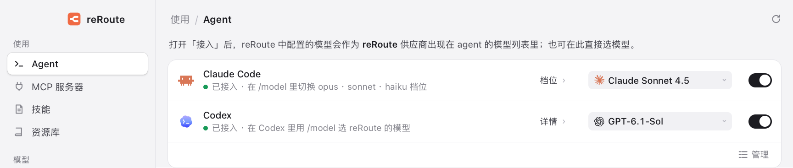
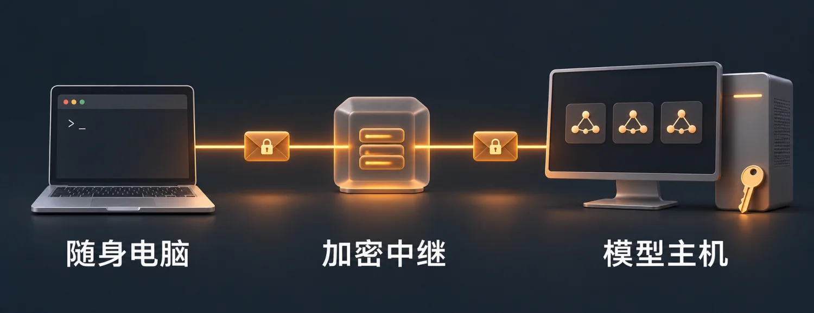

# reRoute for macOS

reRoute 把你已有的模型服务接到 Mac 上的一个本地网关。你可以让 Claude Code 和 Codex 各用不同的模型，也可以让它们共用同一组账号。以后换模型，打开菜单栏里的 reRoute 就能选。

**[下载 Apple 芯片版（M 系列）](https://github.com/BlueOriginAI/reRoute/releases/latest/download/reroute-darwin-arm64.dmg)　·　[下载 Intel 版](https://github.com/BlueOriginAI/reRoute/releases/latest/download/reroute-darwin-amd64.dmg)　·　[最新版本与更新说明](https://github.com/BlueOriginAI/reRoute/releases/latest)**

## 从安装到第一次调用

1. **安装。** 在  →「关于本机」查看芯片类型，下载对应的 DMG。打开后，将 **reRoute.app** 拖入「应用程序」并启动。正式版应用和 DMG 均经 Developer ID 签名和 Apple 公证。
2. **添加模型来源。** 打开「供应商」，选择一个服务商，填入自己的 API Key，或登录受支持的订阅账号。确认供应商下已经列出你要用的模型。
3. **接入 Agent。** 打开「Agent」，找到已安装的 Claude Code、Codex 或其他客户端，开启右侧的接入开关并选择模型。
4. **验证调用。** 在该 Agent 中新开会话，发送「只回复 OK」。收到回复后，打开 reRoute 的「用量」，查看这次请求使用的服务商、模型和 Token。

*图中使用示例配置。你能选择的模型取决于已接入的供应商和账号。*

自己写脚本时，打开「网关 → 连接」，复制应用显示的 Base URL 和调用示例。OpenAI 兼容客户端可先请求 `GET /v1/models`，再把返回的完整模型 ID 填入 `model`。

## 多个账号和模型怎样配合

| 你想做什么 | 在 reRoute 里怎么做 |
| --- | --- |
| 让不同 Agent 分工 | 在「Agent」页给每个工具分别选模型，例如一个负责写代码，另一个负责审阅。 |
| 一个账号额度用完后继续工作 | 在「供应商」添加同一服务商的多个账号。遇到额度或限流时，网关可尝试其他可用账号；同名模型也可通过路由组使用其他可用来源。 |
| 弄清一次请求去了哪里 | 「路由」查看实际应答的账号和回退过程，「用量」查看调用数和 Token。 |
| 在 Agent 中生成图片 | 接入支持生图的供应商，在桌面「文生图」中使用，或将图片生成工具通过 MCP 接给 Agent。 |

本地网关、模型路由和创作工具可免费使用。模型调用消耗所接入服务商的额度。

## 在笔记本上使用另一台 Mac 的模型 · Pro

例如，模型账号都登录在办公室的 Mac 上，出门只带笔记本。登录同一个已开通 reRoute Pro 的 Remocode 账户后，笔记本可以通过加密中继调用办公室的模型。上游 API Key 和订阅凭据留在提供模型的 Mac 上，两台电脑可以处在不同网络。

1. **提供模型的 Mac** 打开「账户 → 远程安全穿透」，点「允许远程连接」。看到「等待连接」后，保持 reRoute 运行、电脑联网。
2. **随身的 Mac** 打开同一页面，点「刷新设备」，再点模型主机旁的「连接」。出现「加密中继」和「断开」按钮即表示已连通。
3. **在随身 Mac 上调用。** 到「Agent」页选远端模型，照常开始会话。提供模型的 Mac 可以在对应设备行查看今日用量，或单独撤销该设备的访问。

**共享边界。** 局域网共享会跳过来自其他 reRoute 的模型。每台远程设备访问主机时固定最多 **16 个请求执行、16 个请求排队**，按到达顺序处理，最长等待 **60 秒**。队满或等候超时返回 HTTP 429。两端都升级到 3.0.19 或更高版本，即可在各自提供模型时使用这些规则。

## 关于此仓库

此仓库用于分发 reRoute 的 macOS 安装包和版本说明。第三方组件及资源的版权和许可证见[第三方声明](THIRD_PARTY_NOTICES.md)。这些声明不授予 reRoute 品牌和产品新增内容通用的开源许可。
